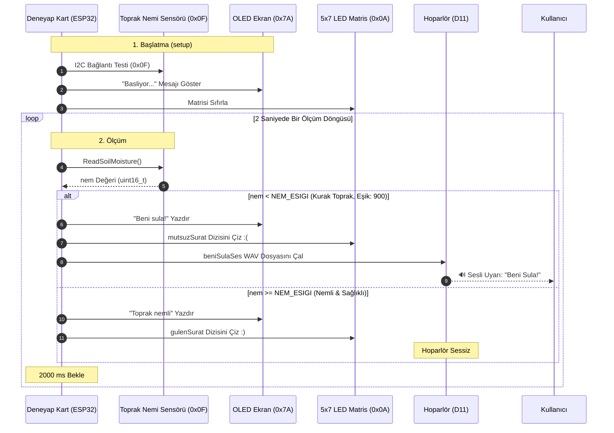

# 🌱 Toprak Nemi Görsel & İşitsel Alarm Sistemi

<p align="center">
  <a href="#donanim-bilesenleri"></a>
  <a href="#yazilim-mimarisi"></a>
  <a href="#devre-baglanti-semasi--i2c-veri-yolu-haritasi"></a>
  <a href="#donanim-bilesenleri"></a>
  <a href="#donanim-bilesenleri"></a>
  <a href="#donanim-bilesenleri"></a>
  <a href="#lisans"></a>
</p>

> **Deneyap Kart** ve I2C çevre birimleri (Toprak Nemi Ölçer, OLED Ekran, 5x7 LED Matris ve Hoparlör) kullanılarak geliştirilmiş; saksı ve tarım alanlarındaki nem seviyesini sürekli takip eden, kritik kuraklık durumunda gülen/mutsuz yüz animasyonları ve gömülü *"Beni Sula!"* WAV ses anonsuyla kullanıcıyı uyaran akıllı bitki bakım istasyonu.

---

## 📑 İçindekiler

1. [Projeye Genel Bakış](#-projeye-genel-bakış)
2. [Öne Çıkan Özellikler](#-öne-çıkan-özellikler)
3. [Donanım Bileşenleri](#-donanım-bileşenleri)
4. [Devre Bağlantı Şeması & I2C Veri Yolu Haritası](#-devre-bağlantı-şeması--i2c-veri-yolu-haritası)
5. [Yazılım Mimarisi & Çalışma Akışı](#-yazılım-mimarisi--çalışma-akışı)
6. [Nem Eşiği ve Durum Göstergeleri](#-nem-eşiği-ve-durum-göstergeleri)
7. [Kurulum ve Çalıştırma Adımları](#-kurulum-ve-çalıştırma-adımları)
8. [Ses Dosyası Mimarisi (beni_sula.h)](#-ses-dosyası-mimarisi-beni_sulah)
9. [Gelecek Geliştirme Fikirleri](#-gelecek-geliştirme-fikirleri)
10. [Geliştirici](#-geliştirici)
11. [Lisans](#-lisans)

---

## 🌟 Projeye Genel Bakış

Bitkilerin düzenli sulanmaması veya aşırı sulanması kök çürümesine ya da kurumaya yol açar. Bu proje, kullanıcıyı karmaşık grafiklerle uğraştırmadan **doğrudan sezgisel görsel ve işitsel geri bildirimlerle** bitkinin su ihtiyacını bildiren akıllı bir istasyondur:

* **Hassas Nem Tespiti:** Deneyap Toprak Nemi Ölçer modülü (I2C: `0x0F`) toprağın nem direncini periyodik olarak dijital formatta okur.
* **Akıllı Eşik Karşılaştırması:** Okunan ham nem değeri kod içerisinde tanımlanan kritik eşik (`NEM_ESIGI = 900`) ile karşılaştırılır.
* **Görsel İfadeler (5x7 Matris):** 
  * Nem yeterliyse (`nem >= 900`): LED matriste **Gülen Yüz (:) )** parlar.
  * Nem düşükse (`nem < 900`): LED matriste **Mutsuz Yüz (:( )** parlar.
* **İşitsel Uyarı (D11 Hoparlör):** Toprak kuruduğunda gömülü PCM WAV kütüphanesinden `"Beni Sula!"` ses anonsu çalınarak anında müdahale çağrısı yapılır.
* **OLED Bilgi Paneli:** Ekranda anlık durum *"Toprak nemli"* veya *"Beni sula!"* metinleriyle net şekilde gösterilir.

---

## ⚡ Öne Çıkan Özellikler

* 💧 **Gerçek Zamanlı Toprak Nemi Takibi:** Dijital I2C toprak sensörüyle yüksek doğrulukta nem ölçümü.
* 😊 **Duygusal ve Sezgisel Arayüz:** 5x7 LED matris üzerinde beliren mutlu / mutsuz yüz ifadeleriyle herkes tarafından anlaşılabilir durum bildirimi.
* 📢 **Sesli Uyarı Desteği:** Ekstra MP3 çalar modülü gerektirmeyen, Deneyap DAC/PWM tabanlı dahili ses motoruyla *"Beni Sula!"* anonsu.
* 🔌 **Modüler I2C Mimarisi:** Toprak sensörü, OLED ekran ve LED matris tek bir I2C (SDA/SCL) hattı üzerinden zincirleme bağlanarak kablo karmaşasını önler.
* ⚡ **Düşük Enerji Tüketimi:** 2 saniyelik periyotlarla yapılan enerji dostu ölçüm döngüsü.

---

## 🧰 Donanım Bileşenleri

| Bileşen | Model / Adres | Görev |
| :--- | :--- | :--- |
| **Ana Kart** | Deneyap Kart (ESP32) | Ölçüm algoritması, I2C yönetimi ve hoparlör sürümü |
| **Nem Sensörü** | Deneyap Toprak Nemi Ölçer (`0x0F`) | Topraktaki nem seviyesini ölçme (Kapasitif/Dirençsel I2C) |
| **Yüz Göstergesi** | Deneyap 5x7 LED Matris (`0x0A`) | Gülen ve mutsuz yüz piksel animasyonu çizimi |
| **Metin Ekranı** | Deneyap OLED Ekran 0.96" (`0x7A`) | "Toprak nemli" / "Beni sula!" metin bildirimi |
| **Ses Modülü** | Deneyap Hoparlör (D11 Pini) | "Beni sula!" WAV ses kaydının çalınması |
| **Bağlantı Hatları**| Qwiic / I2C Jumper Kablolar | Modüller arası veri ve 3.3V/5V güç bağlantıları |

---

## 🔌 Devre Bağlantı Şeması & I2C Veri Yolu Haritası

Sistemdeki tüm dijital sensör ve ekranlar Deneyap Kart'ın ortak **I2C Veri Yolu (SDA & SCL)** üzerinden paralel olarak bağlanmıştır. Hoparlör modülü ise ses sinyali için **D11** pinine bağlanmıştır:

```
                   +----------------------------------+
                   |          Deneyap Kart 1A         |
                   |                                  |
                   |   3.3V   GND   SDA    SCL   D11  |
                   +-----+-----+-----+-----+------+---+
                         |     |     |     |      |
      +------------------+     |     |     +--+   +---------------+
      |         +--------------+     +----+   |                   |
      |         |                         |   |                   |
      v         v                         v   v                   v
+--------------------------+        +--------------------------+  |
| Deneyap Toprak Nemi      |        |  Deneyap 5x7 LED Matris  |  |
|      (I2C: 0x0F)         |        |       (I2C: 0x0A)        |  |
+--------------------------+        +--------------------------+  |
      |         |                         |          |            |
      +---------+--- (Ortak I2C Hattı) ---+----------+            |
      |         |                                                 |
      v         v                                                 |
+--------------------------+                                      |
|    Deneyap OLED Ekran    |                                      |
|        (I2C: 0x7A)       |                                      |
+--------------------------+                                      |
                                                                  |
                   +------------------------------+               |
                   |       Deneyap Hoparlör       |               |
                   |                              |               |
                   |   Signal Pini  <-------------+---------------+
                   |   3.3V / VCC   <------------>  3.3V
                   |   GND          <------------>  GND
                   +------------------------------+
```

### I2C Donanım Adres Haritası

| Modül Adı | I2C Hex Adresi | Protokol | Fonksiyon |
| :--- | :--- | :--- | :--- |
| **Deneyap Toprak Nemi Ölçer** | `0x0F` | I2C | Ham nem verisi okuma (`ReadSoilMoisture()`) |
| **Deneyap 5x7 LED Matris** | `0x0A` | I2C | 35 piksellik ifade matrisi (`mutsuzSurat` / `gulenSurat`) |
| **Deneyap OLED Ekran** | `0x7A` | I2C | 128x64 metin durum ekranı |
| **Deneyap Hoparlör** | *Analog/PWM* | D11 (Kanal 0) | WAV buffer ses çalımı |

---

## 💻 Yazılım Mimarisi & Çalışma Akışı



---

## 📊 Nem Eşiği ve Durum Göstergeleri

Sistemde kullanılan eşik değeri ve donanım çıktıları:

```cpp
const int NEM_ESIGI = 900; // Kritik nem eşiği
```

| Nem Seviyesi | Toprak Durumu | OLED Ekranı | 5x7 LED Matris İfadesi | Hoparlör Durumu |
| :---: | :---: | :---: | :---: | :---: |
| **< 900** | ⚠️ Kuru / Nemsiz | `"Beni sula!"` | **Mutsuz Yüz `:( `** | 🔊 `"Beni Sula!"` Anonsu Çalar |
| **≥ 900** | ✅ Yeterli Nem | `"Toprak nemli"` | **Gülen Yüz `:) `** | 🔇 Sessiz / Normal |

---

## 🚀 Kurulum ve Çalıştırma Adımları

### 1. Kütüphaneleri Yükleme
Arduino IDE / Deneyap IDE içerisinde **Araçlar -> Kütüphaneleri Yönet** sekmesinden aşağıdaki kütüphanelerin kurulu olduğundan emin olun:

* `Deneyap_ToprakNemiOlcer`
* `Deneyap_OLED`
* `Deneyap_5x7LedEkran`
* `Deneyap_Hoparlor`

### 2. Donanım Montajı
1. I2C çevre birimlerini (Toprak Nemi, OLED ve LED Matris) Deneyap Kart'ın **SDA** ve **SCL** pinlerine bağlayın.
2. Hoparlör modülünün sinyal ucunu **D11** pinine takın.
3. Toprak nem sensörünün problarını bitkinizin saksısına yerleştirin.

### 3. Kodu Yükleme
1. `toprak_nemi_gorsel_alarmi.ino` dosyasını açın.
2. `beni_sula.h` dosyasının ana `.ino` dosyasıyla aynı klasörde bulunduğundan emin olun.
3. Kart modelini **Deneyap Kart** olarak seçip kodu derleyin ve yükleyin.

---

## 🔊 Ses Dosyası Mimarisi (`beni_sula.h`)

Sistemde harici SD kart veya MP3 modülüne gerek duyulmaz. Ses dalgaları C++ header formatında doğrudan kartın Flash belleğine kaydedilmiştir:

```cpp
#include "beni_sula.h"
Speaker speaker(D11, 0);
Wav beniSulaSes(beni_sula);

// Nem düştüğünde ses çalma döngüsü:
speaker.Play(&beniSulaSes);
while (speaker.AlreadyPlaying(&beniSulaSes)) {
  speaker.FillBuffer();
}
```

---

## 👩‍💻 Geliştirici

**Kevser ÜSTÜN**  
🎓 Giresun Üniversitesi — Bilgisayar Mühendisliği  
🔗 [GitHub Profilim](https://github.com/kvsrustun)  
📦 [Proje Deposu](https://github.com/kvsrustun/toprak_nemi_gorsel_alarmi)

---

## 📄 Lisans

Bu proje [MIT Lisansı](LICENSE) kapsamında açık kaynak olarak sunulmuştur.
